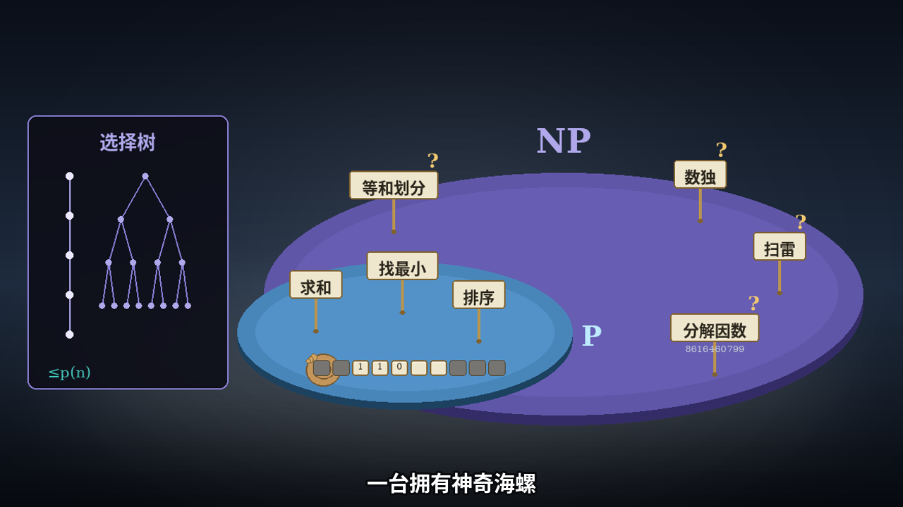

**English** | [简体中文](README.zh-CN.md)

<div align="center">

# simulation-explainer-video

**Most explainer videos are slides with narration laid on top. This is an agent skill pack for making the other kind: a Turing machine that actually runs on screen, a balance scale that sums live, a choice tree that grows exactly one green path — every visual driven by a real, running simulation.**

[](LICENSE)
[](https://github.com/LiangGou/simulation-explainer-video/stargazers)
[](requirements.txt)

</div>

<p align="center">
  <a href="#the-method-in-5-lines">Method</a> •
  <a href="#quickstart-for-an-agent">Quickstart</a> •
  <a href="#architecture-three-layers">Architecture</a> •
  <a href="#requirements">Requirements</a> •
  <a href="#worked-example">Worked example</a> •
  <a href="#license">License</a>
</p>

**Watch:** [the side-by-side comparison](https://github.com/LiangGou/simulation-explainer-video/blob/main/examples/turing-machine-np/output/comparison-v1.mp4) — the original segment on top, the imitation below, aligned shot by shot. **Read:** [Muse Amazed Me Again — With One-Shot Imitation Learning](https://lianggou.github.io/2026/11/08/muse-amazed-me-again-explainer-video.html) — the blog post about how one demonstration became this skill pack, and what imitation learning's own mathematics says about the result. **The imitation on its own:** [turing-segment-v1.mp4](https://github.com/LiangGou/simulation-explainer-video/blob/main/examples/turing-machine-np/output/turing-segment-v1.mp4).

**The short version:** an agent skill + rendering engine for making **simulation-driven explainer videos** — decompose the topic into beats, give every beat a working simulation whose computed state drives the picture, put the narration on last, and verify every spoken number by dual-model ASR before delivery.

An agent skill + rendering engine for making **simulation-driven explainer videos**: the kind where a Turing machine actually runs on screen, a balance scale sums live, and a choice tree grows one green path — instead of slides with narration on top.

The method is reverse-engineered from the explainer videos of 漫士沉思录 (Manshi / Lu Rui), whose P-vs-NP episode runs a real Turing machine for five minutes as its central argument. The decomposition method — not just the look — is documented in `docs/METHOD.md`.

<div align="center">



*The signature frame of the worked example: the P ⊆ NP platform.*

</div>

> Status: working skill pack and engine, with one complete worked episode included. Python 3.10+ with Pillow and ffmpeg; a `timeline.json` is committed in the example, so the example renders end-to-end immediately. Narration needs a TTS plug (any CLI) — see `docs/adapters.md`.

## Highlights

- **Working simulations, not illustrations** — each beat's computed state drives every visual; numbers are never typed by hand.
- **Decomposition before building** — beats, transitions, and narration are locked in a script first; definitions arrive late, after demonstration, metaphor, and a full instance.
- **One stage, one palette** — a single consistent visual system for the whole video; thesis statements land as title cards, not subtitles.
- **Verified numbers** — audio goes on last, and every spoken number is checked by dual-model ASR before delivery.
- **A skill, not a script** — `SKILL.md` carries the whole method, the production workflow, the engine API, and the done-criteria, so any agent (Muse, Claude Code, Codex) can run it on a new topic.

## Contents

- [The method in 5 lines](#the-method-in-5-lines)
- [Quickstart (for an agent)](#quickstart-for-an-agent)
- [Architecture (three layers)](#architecture-three-layers)
- [Repo layout](#repo-layout)
- [Requirements](#requirements)
- [Worked example](#worked-example)
- [Credits](#credits)
- [License](#license)

## The method in 5 lines

1. Decompose the topic into beats; lock each beat's topic, transition, and narration in a script **before** building.
2. Give each beat a **working simulation** — the computed state drives every visual; numbers are never typed by hand.
3. One stage, one palette for the whole video; thesis statements land as title cards, not subtitles.
4. Definitions arrive late: demonstration → everyday metaphor → full instance → definition.
5. Audio last; then verify every spoken number by dual-model ASR before delivery.

## Quickstart (for an agent)

Clone this repo into your agent's skills folder (or anywhere), then point your agent at **`SKILL.md`** — it contains the whole method, the production workflow, the engine API, and the done-criteria. To render the worked example end-to-end:

```bash
pip install -r requirements.txt        # Pillow (+ optional faster-whisper for QA)
python3 -m engine.synth examples/turing-machine-np     # narration -> timeline.json (needs a TTS plug, see docs/adapters.md)
python3 -m engine.build examples/turing-machine-np stills   # QA stills — read them
python3 -m engine.build examples/turing-machine-np          # full render -> turing-segment-v1.mp4
python3 -m engine.qa asr examples/turing-machine-np         # dual-ASR number check
python3 -m engine.qa frame0 examples/turing-machine-np/turing-segment-v1.mp4
```

(A `timeline.json` is committed in the example, so `engine.build` works immediately; re-run `engine.synth` only after changing the script.)

To start your own episode: copy `templates/episode/` to `examples/<your-topic>/`, write the script with `templates/script-template.md` and the shot-spec with `templates/shot-spec-template.md`, fill in `episode.py`, and run the same commands.

## Architecture (three layers)

- **`engine/`** — mechanism only, topic-blind: frame loop, easing, glow rendering, stage + palette, subtitle burner, timeline, ffmpeg assembly, TTS/ASR adapter interfaces, QA harness.
- **`engine/archetypes/`** — parameterized simulation patterns that recurred across episodes: `tape_machine`, `weighted_mix`, `branching_tree`, `accumulator_scale`, `containment_stage`, `title_card`. Each takes data/config; none contains episode content.
- **Episodes** (`examples/<topic>/`) — generated fresh per topic: script, sim definitions (archetype instantiations with the episode's data), and shot choreography glue. An episode is a folder with an `episode.py` exposing `SEGMENTS`, `SUBS`, `SCENES`, `ORDER`, `PADS`, `PROBES` — the engine renders any such folder the same way.

Growth discipline: abstract only what has recurred in two episodes; a shape needed once stays in the episode layer; on its third appearance it graduates to the archetypes. See `docs/DESIGN.md`.

## Repo layout

```
SKILL.md                  the skill: method, workflow, engine API, done-criteria
docs/METHOD.md            the decomposition method in depth
docs/DESIGN.md            the three-layer architecture + growth discipline
docs/adapters.md          TTS / ASR adapter interfaces (+ Muse worked example)
engine/                   frame pipeline, stage, timeline, subs, synth, build, QA
engine/archetypes/        the six simulation patterns
templates/                script + shot-spec skeletons, episode starter
examples/turing-machine-np/   the complete worked episode (script, spec, sims, stills)
```

## Requirements

- Python 3.10+ and [Pillow](https://pypi.org/project/Pillow/)
- `ffmpeg` / `ffprobe` on PATH
- A TTS plug for narration (any CLI; configured via `SEV_TTS_CMD` / `SEV_TTS_BIN` — see `docs/adapters.md`). The reference environment uses Muse's built-in TTS with the Aria voice.
- Optional: `faster-whisper` for the ASR number-verification harness.
- Fonts: the stage resolves Noto CJK / DejaVu by default; override per role with `SEV_FONT_*` environment variables.

## Worked example

`examples/turing-machine-np/` is a complete episode: the Turing-machine beat of the P-vs-NP story — a parity machine that really runs (δ table, step counter, board highlight driven by the executed run), a partition machine with a live-sum balance ending 254 = 254, a branching choice tree with one green path, the 19-vs-9216 accounting coda, and the P ⊆ NP platform as the signature frame. Its README maps every beat onto the engine and archetypes. The rendered videos are in this repo: the imitation, [`output/turing-segment-v1.mp4`](examples/turing-machine-np/output/turing-segment-v1.mp4) (4:34.5, 1280×720), and the [side-by-side comparison](examples/turing-machine-np/output/comparison-v1.mp4) with Manshi's original (4:47) — both play directly on their GitHub pages.

## Credits

The method — and the demonstration it was learned from — belongs to 漫士沉思录 (Manshi / Lu Rui): his P-vs-NP episode is the worked example's source, and the decomposition documented in `docs/METHOD.md` is his, reverse-engineered frame by frame. The skill pack around it was built with Muse, Meta's personal AI agent, under its owner's direction.

**If this pack helps your agent explain something hard, consider starring the repo** — it helps other agent builders find it.

## License

MIT — see [LICENSE](LICENSE).
